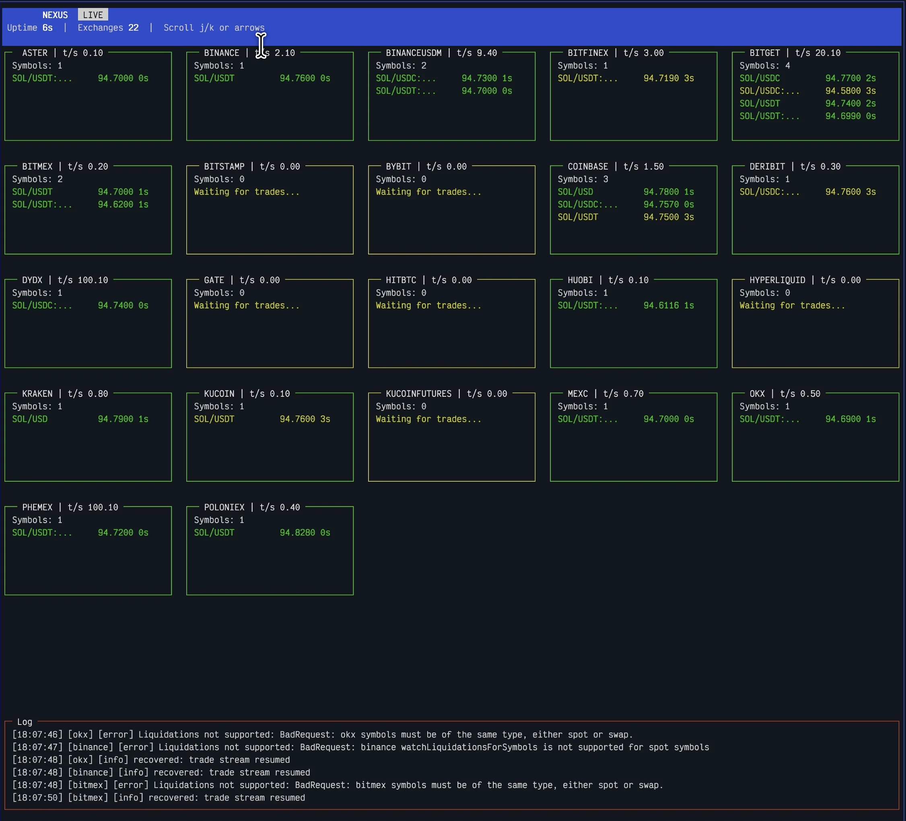

# SIO Nexus

SIO Nexus is a Bun-based market data backend for crypto trading pairs. It watches live exchange trade streams, aggregates them into unified klines, persists closed candles to SQLite, and exposes both real-time and historical data over Unix sockets.

The current runtime is centered around:

- live trade and liquidation ingestion from multiple exchanges through `ccxt`
- normalized pair aggregation across spot and derivatives markets
- batched SQLite persistence for closed klines
- a query socket for historical reads
- an aggregation socket for streaming live bucket updates
- a market scanner socket for real-time exchange-wide stats
- optional terminal dashboards for operators

## Some screenshots



## Features

- Aggregates multiple exchange symbols into a single logical pair such as `SOLUSDT`
- Produces unified OHLCV-style candles with buy/sell cost, volume, and liquidation metrics
- Persists closed candles for `1m`, `5m`, `15m`, `1h`, `4h`, and `1d`
- Streams in-progress (`delta`) and closed (`full`) buckets over a Unix socket
- Scans Binance market data for pairs that are tradeable on Phemex and streams rolling stats
- Serves historical and metadata queries from SQLite over a separate Unix socket
- Imports historical Binance `1m` data and rolls it up into higher timeframes
- Supports a terminal dashboard for monitoring exchange workers and prices

## Architecture

At a high level, the runtime flow is:

1. `src/main.ts` loads `nexus-config.json`
2. `NexusServer` starts Unix socket servers:
   - aggregation socket: real-time candle updates
   - query socket: historical SQLite queries
   - market scanner socket: exchange-wide rolling stats
3. One worker per exchange is spawned through `ExchangeWorker.ts`
4. Workers watch trades, and where supported, liquidation feeds
5. `TickAggregator` maps exchange symbols into logical pairs and updates timeframe buckets
6. Closed buckets are buffered by `KlinesBuffer` and flushed into SQLite on an interval

## Repository Layout

```text
src/
  main.ts                        CLI entrypoint
  config.ts                      Environment-driven runtime config
  domain/                        Candle and timeframe types
  nexus/
    NexusServer.ts               Main runtime coordinator
    ExchangeWorker.ts            Per-exchange watcher worker
    AggrSocketServer.ts          Real-time aggregation socket
    QuerySocketServer.ts         Historical query socket
    aggregator/                  Bucket logic and buffering
  utils/
    db/                          SQLite helpers
    klinesDownloader/            Historical download/normalize/import pipeline
data/                            SQLite DB and downloaded historical files
scripts/                         Deploy script and systemd service unit
```

## Requirements

- [Bun](https://bun.sh/) installed
- `unzip` available in `PATH` for the historical download workflow
- A writable `data/` directory
- A valid `nexus-config.json` file at the project root, or a custom path provided through env

## Installation

```bash
bun install
```

## Quick Start

1. Create or edit `nexus-config.json`
2. Start the server:

```bash
bun run dev
```

That runs:

```bash
bun run --watch src/main.ts run
```

To run without watch mode:

```bash
bun run src/main.ts run
```

To enable the terminal dashboard:

```bash
bun run dashboard
```

## Configuration

There are two configuration layers:

- environment variables for runtime paths and logging
- `nexus-config.json` for aggregation pairs, DB path, and flush interval

### Environment Variables

| Variable                        | Default                       | Description                                    |
| ------------------------------- | ----------------------------- | ---------------------------------------------- |
| `SIO_NEXUS_ENV`                 | `prod`                        | Runtime environment name                       |
| `SIO_NEXUS_IS_BINARY`           | `false`                       | Set to `true` when running the compiled binary |
| `SIO_NEXUS_SHOW_INIT_BANNER`    | `false`                       | Show startup banner                            |
| `SIO_NEXUS_CONFIG_FILE_PATH`    | `./nexus-config.json`         | Path to the Nexus config file                  |
| `SIO_NEXUS_LOG_ENABLED`         | `false`                       | Enable logging                                 |
| `SIO_NEXUS_LOG_LEVEL`           | `warn`                        | Log level                                      |
| `SIO_NEXUS_LOG_DIR`             | `./logs`                      | Log directory                                  |
| `SIO_NEXUS_WRITE_LOG_TO_FILES`  | `false`                       | Write logs to files                            |
| `SIO_NEXUS_AGGR_SOCKET_PATH`    | `/tmp/sio-nexus-aggr.sock`    | Real-time aggregation socket path              |
| `SIO_NEXUS_QUERY_SOCKET_PATH`   | `/tmp/sio-nexus-query.sock`   | Historical query socket path                   |
| `SIO_NEXUS_SCANNER_SOCKET_PATH` | `/tmp/sio-nexus-scanner.sock` | Market scanner socket path                     |

### `nexus-config.json`

The project loads JSON5, so comments are allowed. A minimal example:

```json5
{
  secondsBufferFlushToDB: 10,
  sqliteKlinesDBPath: './data/klines.db',
  marketScanner: {
    enabled: true,
    sourceExchangeId: 'binance',
    tradableExchangeId: 'phemex',
    statsWindowMs: 60000,
    publishIntervalMs: 1000,
    subscribeDelayMs: 25,
  },
  aggregatedPairs: {
    SOLUSDT: [
      { exchangeId: 'binance', pairs: ['SOL/USDT', 'SOL/USDC'] },
      {
        exchangeId: 'binanceusdm',
        pairs: ['SOL/USDT:USDT', 'SOL/USDC:USDC'],
        mainPriceTracker: true,
      },
    ],
  },
}
```

### Aggregated Pair Model

Each key in `aggregatedPairs` is the logical pair exposed by Nexus. Each entry under that key declares which exchange markets should contribute to the aggregate.

Fields:

- `exchangeId`: exchange name used by `ccxt`
- `pairs`: list of market symbols to watch on that exchange
- `mainPriceTracker`:
  when `true`, those symbols are allowed to drive OHLC prices for the aggregate

This lets you combine liquidity from several markets while keeping one preferred price source for candle OHLC values.

### Market Scanner

`marketScanner` runs alongside the normal aggregation pipeline. It discovers markets with `ccxt`, builds the intersection between markets tradeable on Phemex and markets available on Binance, watches Binance trades for that intersection, computes rolling per-symbol stats, and broadcasts snapshots through `/tmp/sio-nexus-scanner.sock`.

Available fields:

- `enabled`: start the scanner with `run`
- `sourceExchangeId`: market-data source exchange; default `binance`
- `tradableExchangeId`: exchange used to decide which pairs are tradeable; default `phemex`
- `marketTypes`: optional list such as `['spot', 'swap']`; applied to the tradeable exchange
- `quoteCurrencies`: optional list such as `['USDT']`; applied to the tradeable exchange
- `includeSymbols` / `excludeSymbols`: exact symbols, `*` wildcards, or `/regex/`; applied to the tradeable exchange
- `maxSymbols`: optional cap for development tests
- `statsWindowMs`: rolling stats window
- `publishIntervalMs`: socket snapshot interval
- `subscribeDelayMs`: throttle between source subscriptions; Binance uses `watchTradesForSymbols` in chunks of up to 200 symbols

## CLI Commands

| Command                                                    | Description                                                  |
| ---------------------------------------------------------- | ------------------------------------------------------------ |
| `bun run dev`                                              | Start in watch mode                                          |
| `bun run dashboard`                                        | Start the server with the terminal dashboard enabled         |
| `bun run market-scanner`                                   | Start the server with the market scanner enabled             |
| `bun run market-scanner-dashboard`                         | Open the market scanner terminal dashboard                   |
| `bun run test`                                             | Run Bun tests                                                |
| `bun run typecheck`                                        | Run TypeScript checks                                        |
| `bun run lint`                                             | Run ESLint                                                   |
| `bun run build`                                            | Build the Linux x64 binary                                   |
| `bun run clean`                                            | Remove `build/` and `logs/`                                  |
| `bun run download-historical-data <start> <end>`           | Download, normalize, and import Binance `1m` historical data |
| `bun run import-historical-klines <PAIR> <CSV_PATH>`       | Import normalized `1m` historical candles into SQLite        |
| `bun run src/main.ts normalize-historical-data <CSV_PATH>` | Normalize a raw historical CSV into Nexus format             |

## Runtime Outputs

When running, Nexus creates these Unix sockets:

- aggregation socket: streams live bucket updates
- query socket: accepts request/response JSON lines for SQLite reads
- market scanner socket: streams exchange-wide rolling stat snapshots

By default:

- `/tmp/sio-nexus-aggr.sock`
- `/tmp/sio-nexus-query.sock`
- `/tmp/sio-nexus-scanner.sock`

It also writes SQLite data to the path declared in `nexus-config.json`, for example:

```text
./data/klines.db
```

## Aggregation Socket

The aggregation socket is a newline-delimited JSON stream. Every message includes:

- `pair`
- `timeframe`
- `type`: `delta` for in-progress bucket updates, `full` for a closed bucket
- candle fields such as `timestamp`, `open`, `high`, `low`, `close`
- cost, volume, trade count, and liquidation metrics

Example message:

```json
{
  "pair": "SOLUSDT",
  "timeframe": "1m",
  "type": "delta",
  "timestamp": 1773725340000,
  "open": 141.2,
  "high": 141.5,
  "low": 141.1,
  "close": 141.4,
  "buyCost": 12850.55,
  "sellCost": 9733.21,
  "buyVolume": 91.4,
  "sellVolume": 69.2,
  "liqBuyCost": 0,
  "liqSellCost": 0,
  "liqBuyVolume": 0,
  "liqSellVolume": 0,
  "tradeCount": 184,
  "liqCount": 0
}
```

## Query Socket

The query socket also uses newline-delimited JSON.

Supported `queryType` values:

- `info`: list available klines tables, ranges, and timeframes
- `last`: fetch the last `N` candles per timeframe
- `range`: fetch candles inside a timestamp window

### `info` request

```json
{ "queryType": "info" }
```

### `last` request

```json
{
  "queryType": "last",
  "pair": "SOLUSDT",
  "timeframes": ["1m", "5m", "1h"],
  "limit": 50
}
```

### `range` request

```json
{
  "queryType": "range",
  "pair": "SOLUSDT",
  "timeframes": ["1m", "5m"],
  "startDate": 1773638400000,
  "endDate": 1773724800000
}
```

### Query Responses

The server responds with JSON lines of these forms:

- `{"type":"info","info":...}`
- `{"type":"kline","kline":...}`
- `{"type":"end","count":123}`
- `{"type":"error","message":"..."}`

For multi-timeframe reads, `range` results are emitted in timestamp order across the selected timeframes.

## Market Scanner Socket

The market scanner socket is a newline-delimited JSON stream. The main message is `market-scanner-snapshot`:

```json
{
  "type": "market-scanner-snapshot",
  "exchangeId": "binance",
  "timestamp": 1773725340000,
  "windowMs": 60000,
  "symbolsCount": 250,
  "activeSymbolsCount": 120,
  "totals": {
    "tradeCount": 4200,
    "tradesPerSecond": 70,
    "buyCost": 1800000,
    "sellCost": 1700000,
    "totalCost": 3500000,
    "totalVolume": 42000,
    "netCost": 100000
  },
  "symbols": [
    {
      "exchangeId": "binance",
      "symbol": "SOL/USDT",
      "lastPrice": 141.4,
      "tradeCount": 184,
      "tradesPerSecond": 3.07,
      "totalCost": 22583.76,
      "netCost": 3117.34,
      "priceChangePct": 0.42,
      "priceChange5mPct": 1.85,
      "priceChange15mPct": -0.33,
      "priceChange1hPct": 4.91
    }
  ]
}
```

`priceChangePct` is the realtime scanner-window change. The scanner also emits 5-minute, 15-minute, and 1-hour change fields, plus `market-scanner-started` and `market-scanner-error` events.

## SQLite Schema

Klines are stored in per-pair, per-timeframe tables:

```text
klines_<PAIR>_<TIMEFRAME>
```

Example:

```text
klines_SOLUSDT_1m
```

Each table contains:

- `timestamp`
- `open`
- `high`
- `low`
- `close`
- `buyCost`
- `sellCost`
- `buyVolume`
- `sellVolume`
- `liqBuyCost`
- `liqSellCost`
- `liqBuyVolume`
- `liqSellVolume`
- `tradeCount`
- `liqCount`

## Historical Data Workflow

Nexus includes a Binance historical pipeline for bootstrapping the SQLite database.

### One-step download, normalize, and import

```bash
bun run download-historical-data 2026-01-01 2026-01-31
```

What it does:

1. Downloads Binance USD-M `SOLUSDT` `1m` klines
2. Unzips and merges the downloaded CSV parts
3. Normalizes the CSV into the Nexus schema
4. Imports `1m` data into SQLite
5. Aggregates and imports `5m`, `15m`, `1h`, `4h`, and `1d`

Generated output:

```text
data/historical/SOLUSDT-1m/SOLUSDT.csv
```

### Import an already normalized CSV

```bash
bun run import-historical-klines SOLUSDT data/historical/SOLUSDT-1m/SOLUSDT.csv
```

### Normalized CSV Format

Imported CSV files must use this header:

```csv
timestamp,open,high,low,close,buyCost,sellCost,buyVolume,sellVolume,liqBuyCost,liqSellCost,liqBuyVolume,liqSellVolume,tradeCount,liqCount
```

Notes:

- the importer expects sorted ascending timestamps
- the importer is designed for normalized `1m` source data
- liquidation columns may be zero for exchange exports that do not include them

## Development

Run the main validation commands before opening a PR:

```bash
bun run test
bun run typecheck
bun run lint
```

## Build

Create the Linux x64 binary:

```bash
bun run build
```

Output:

```text
build/x64/sio-nexus
```

## Deployment

The deployment script:

```bash
bun run deploy
```

Current behavior:

- runs typecheck and build
- copies `build/x64/sio-nexus` to the remote host with `rsync`
- restarts `sio-nexus` through `systemctl`

The script expects SSH settings in `.env`:

- `SIO_NEXUS_SSH_HOST`
- `SIO_NEXUS_SSH_USERNAME`
- `SIO_NEXUS_SSH_PORT`

## Notes and Limitations

- The built-in historical downloader is currently hardcoded to Binance USD-M `SOLUSDT` `1m`
- Live aggregation timeframes currently persist `1m`, `5m`, `15m`, `1h`, `4h`, and `1d`
- Socket APIs are Unix-socket based, so clients must run on the same machine or through their own forwarding layer

## License

This project is licensed under the GNU General Public License v3.0. See [LICENSE](./LICENSE).
